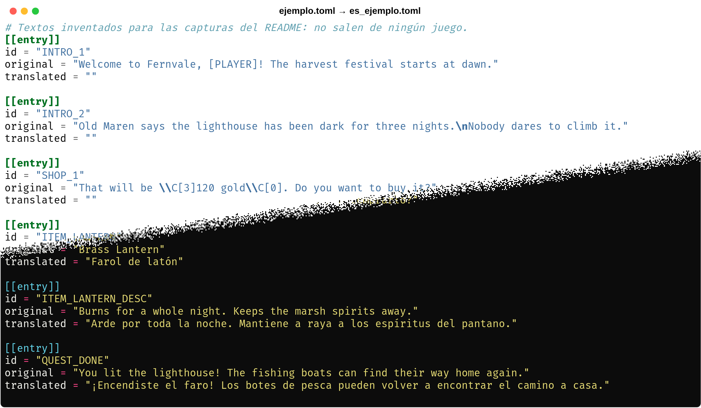
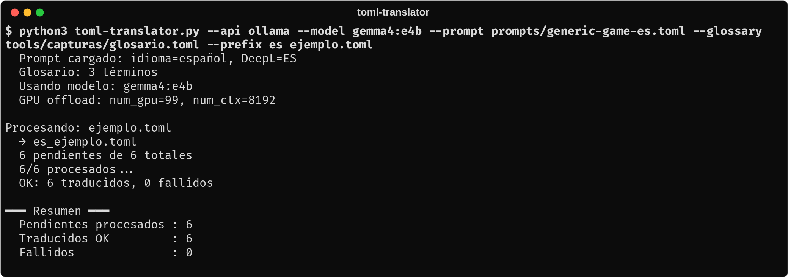
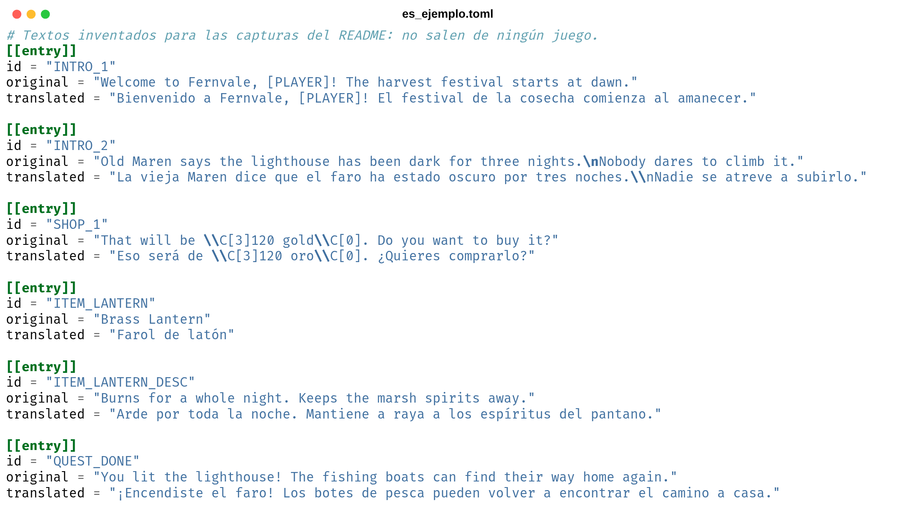

<div align="center">

# toml-translator

**Traducción automática de textos de videojuegos, con modelos locales o en la nube.**


</div>

---

## Qué es

toml-translator traduce los textos de un juego a partir de un formato intermedio en TOML, sin
depender del motor. Unos extractores sacan el texto del juego a TOML, el traductor lo procesa por
lotes con un modelo de lenguaje y los inyectores lo devuelven al juego, como idioma nuevo y sin
pisar el original.

<p align="center">
  
</p>
<p align="center">
  
  
</p>

<p align="center"><sub>Textos inventados, traducidos con <code>gemma4:e4b</code> en Ollama y un glosario de tres términos. Se regeneran con <code>tools/capturas/capturas.py</code>.</sub></p>

## Funciones principales

- Backends: **Ollama** (local), OpenAI, Claude y DeepL.
- Prompts por juego o género, glosarios de términos canónicos y enrutado por contenido.
- Traducción a partir de varios idiomas de referencia a la vez.
- Validación de marcadores y códigos de control, reintentos y reanudación.
- Extractores e inyectores para **RPG Maker XP** y **Pixel Game Maker MV**.

## Tecnologías

| Capa | Tecnología |
|---|---|
| Traductor | Python 3, con parser TOML propio |
| Extractores | Ruby (RPG Maker XP) y Python (Pixel Game Maker MV, con descifrado Twofish) |
| Modelos | Ollama, OpenAI, Anthropic Claude, DeepL |

## Puesta en marcha

```bash
python3 toml-translator.py juego.toml --api ollama --prompt prompts/generic-game-es.toml
python3 toml-translator.py juego.toml --api ollama --dry-run
```

Las claves de las API en la nube se leen de variables de entorno: ver la guía.

## Documentación

- [`docs/guia.md`](docs/guia.md): uso, opciones, formatos y backends.
- [`docs/`](docs/): arquitectura, decisiones y mediciones de modelos.

## Licencia

Código bajo **GPL-3.0-or-later** ([`LICENSE`](LICENSE)). Los componentes de terceros y sus licencias
están en [`NOTICE`](NOTICE). El nombre y la identidad visual no forman parte de la licencia: ver
[`TRADEMARKS.md`](TRADEMARKS.md). Para aportar, [`CONTRIBUTING.md`](CONTRIBUTING.md).

## Apoyo

Este proyecto forma parte del trabajo de **NoctiVulp**: herramientas para Linux y Android,
publicadas como software libre. Las compilaciones oficiales y las novedades salen en Patreon.

<p align="center">
  <a href="https://www.patreon.com/cw/NoctiVulp"></a>
</p>

---

<p align="center"><sub>© 2026 NoctiVulp · <b>Powered by AI</b> — desarrollado con la asistencia de Claude, de Anthropic.</sub></p>
